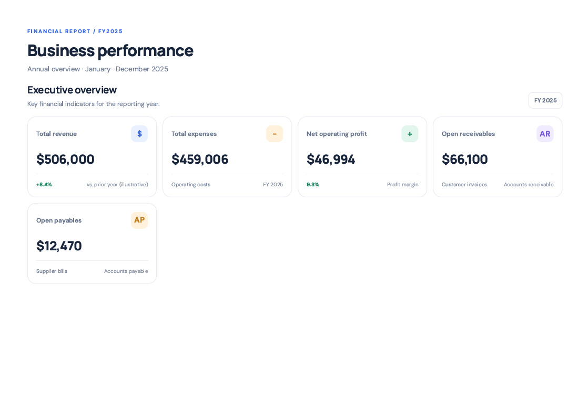

# Northstar Financial Reporting Dashboard

A portfolio project demonstrating end-to-end financial reporting, data validation, reconciliation checks, and interactive dashboard development using HTML, CSS, JavaScript, JSON, and CSV.

**Portfolio project · Fictional business data · Not an audited financial statement**

## Project links

- **Live Dashboard:** [(https://github.com/jshahi660/northstar-financial-reporting-dashboard/tree/main/Northstar_Portfolio)]
- **PDF Report:** [(https://github.com/jshahi660/northstar-financial-reporting-dashboard/blob/main/Northstar_Portfolio/Northstar%20_%20Financial%20Performance%20Report.pdf)]
- **Case Study:** [(https://github.com/jshahi660/northstar-financial-reporting-dashboard/blob/main/Northstar_Portfolio/CASE_STUDY.md)]
- **Source Code:** [(Northstar_Portfolio/source/)]
- **Screenshots:** [(Northstar_Portfolio/screenshots/)]

## Project overview

This project demonstrates how business data can be transformed into a structured financial reporting experience. It combines an interactive browser-based dashboard with a printable six-page financial report.

The aim is to make key financial indicators easier to review while keeping the underlying calculations and validation checks transparent.

## Key financial results

| Metric | Reported value |
|---|---:|
| Revenue | $506,000 |
| Expenses | $459,006 |
| Operating profit | $46,994 |
| Operating margin | 9.3% |
| Open accounts receivable | $66,100 |
| Accounts payable | $12,470 |
| Total assets | $221,500 |
| Total liabilities | $42,870 |
| Total equity | $178,630 |
| Balance sheet difference | $0 |

*All figures use fictional portfolio data and demonstrate the calculations implemented in this project. They do not represent real client results.*

## Screenshots

### Executive summary

### Monthly Financial Details

### Additional dashboard views

Browse the `Northstar_Portfolio/screenshots/` folder for the remaining screenshots. Confirm the filenames match the links before publishing.

## Features demonstrated

- Financial KPI reporting and performance summaries
- Browser-based dashboard built with HTML, CSS, and JavaScript
- JSON and CSV data sources
- Revenue, expense, and profitability analysis
- Financial statement presentation
- Reconciliation checks, including a zero-difference balance sheet
- Printable PDF report generation
- Clear presentation of financial metrics for business review

## Tools and technologies

- HTML, CSS, and JavaScript
- JSON and CSV
- Python-based local serving and project tooling
- PDF reporting

## How to run locally

1. Clone or download this repository.
2. Open a terminal and navigate to the dashboard's source directory.
3. Run:

   `python -m http.server 8000`

4. Open `http://localhost:8000` in your browser.

If the dashboard uses a different entry file or requires a different working directory, follow the instructions in `Northstar_Portfolio/source/README.md`.

## What this project demonstrates

I built this as an independent portfolio project to demonstrate my approach to organizing financial data, checking calculations, presenting KPIs, and creating a browser-based reporting interface.

The focus is on clear reporting, traceable figures, and validation—not on claiming client outcomes.

## Disclaimer

Northstar is a fictional business used for demonstration purposes. The data and financial results are illustrative, not audited, and should not be interpreted as investment, accounting, tax, or financial advice.